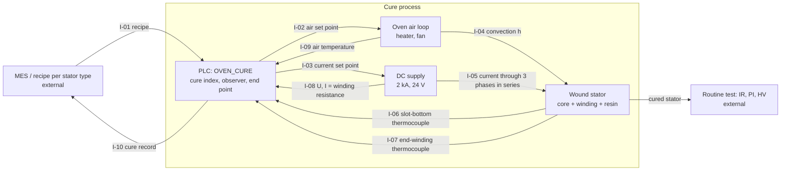
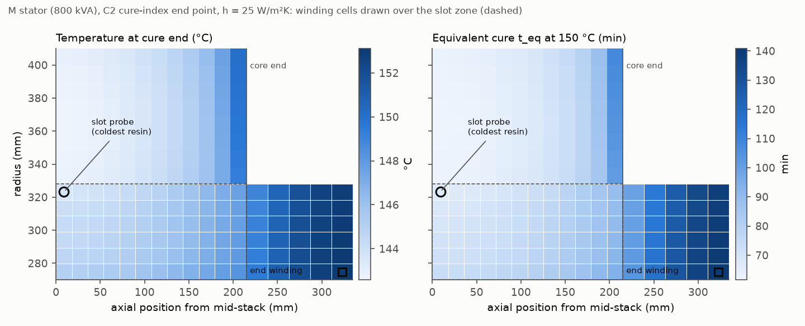
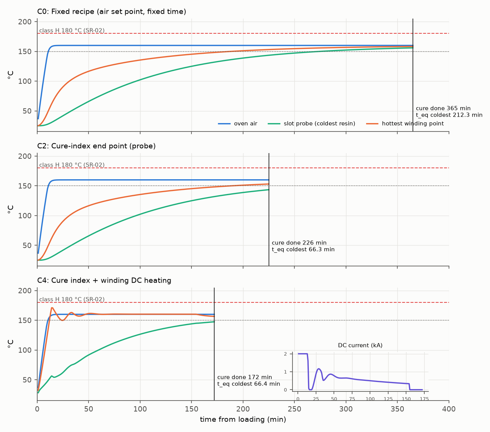
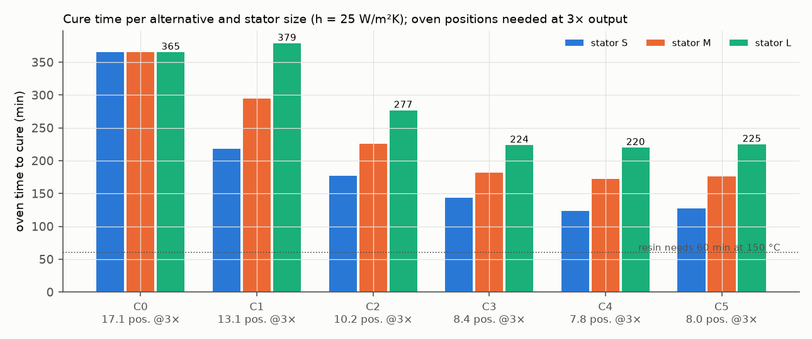
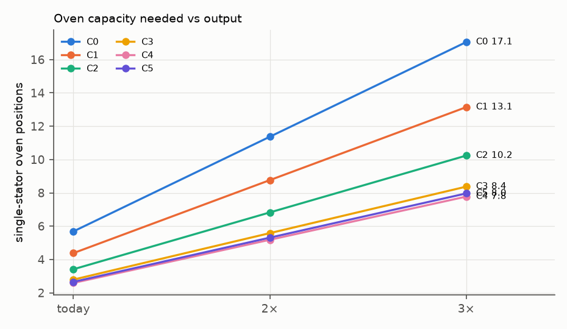
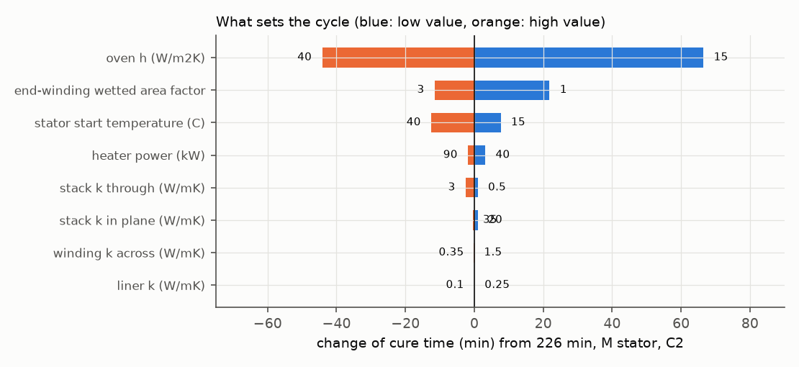
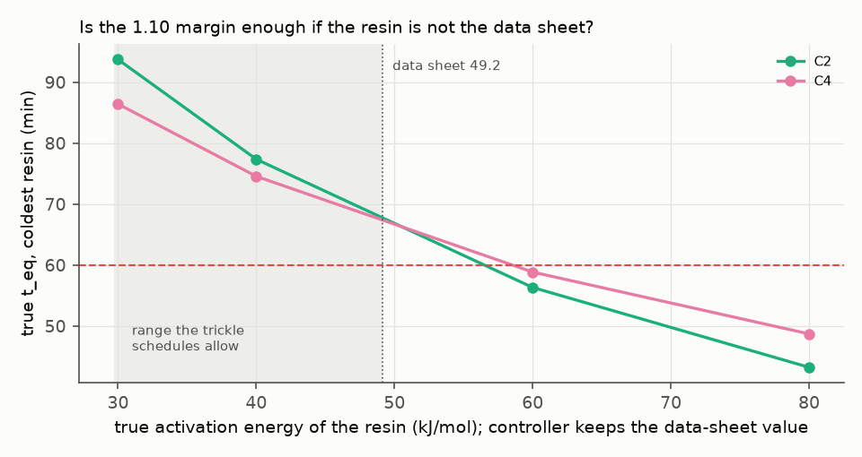
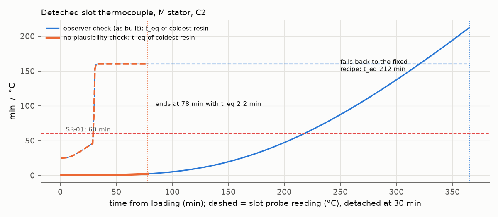
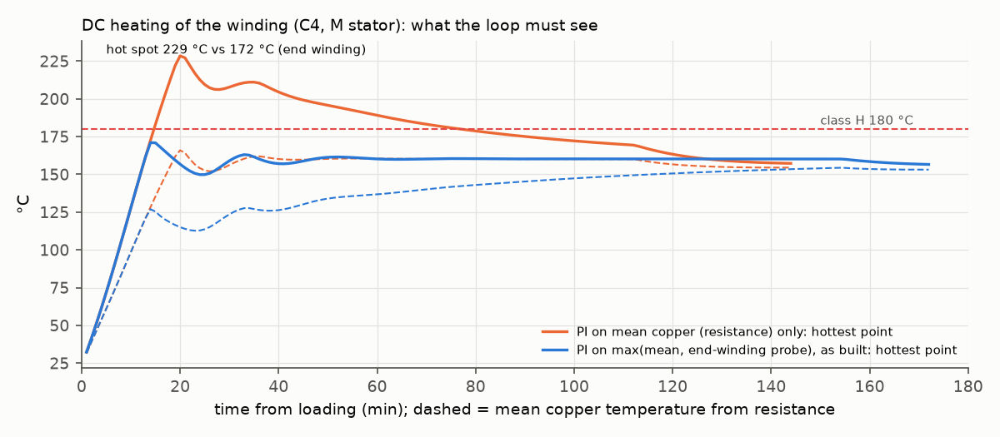
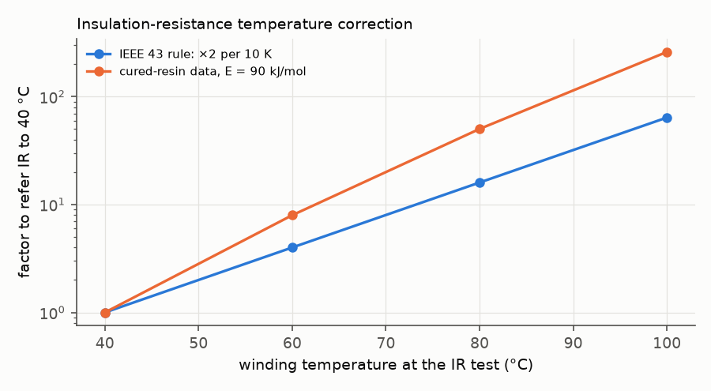

# Cure cycle of an impregnated LV-alternator stator: heat transfer, end-point control and oven capacity

**Systems-engineering dossier, revision 1.0 (10 Nov 2026).** Tables marked "generated" are written from
`results/studies.json` by `scripts/make_tables.py`; no result number is typed by hand. Every cycle in this study is
run by the compiled IEC 61131-3 controller (`plc/st/oven_cure.st`, matiec) against a finite-volume model of the
stator in the oven.

**Central question.** After dipping, a wound stator goes into a curing oven. The resin data sheet asks for 1 h at
150 °C *object* temperature. How long must the oven cycle really be so that the slowest resin in the winding gets that
cure, which process or control change shortens it safely, and how many oven positions does a plant need when its
output is tripled?

**Short answer.** The cycle is set by heat transfer, not by the resin. The coldest resin is always at the slot bottom
in the middle of the stack; it reaches the data-sheet cure after 177 / 226 / 277 min for the S / M / L stators
(cure-index end point, C2), against 66 min of chemistry with margin. Heat transfer is 63–76 % of the cycle. The
surface heat-transfer coefficient decides it: h = 15 → 40 W/m²K moves the M stator from 292 to 182 min, while ±50 %
on every conductivity inside the core moves it by 3 min or less. A fixed recipe that must cover all three sizes on a
bad day (h = 15) runs 365 min; at 3× output that needs 17.1 single-stator oven positions. Ending the cycle on the
cure index measured at the slot bottom needs 10.2; an air-temperature boost 8.4; DC heating of the winding 7.8.

Two design rules come out of the closed-loop runs:
- the cure-index end point is only safe with a plausibility check on its probe. A thermocouple that slips out of the
  slot at 30 min ends the cycle at 78 min with the coldest resin at 2.2 min of its 60 min cure, and nothing alarms;
- DC heating must be closed on the end winding, not on the winding resistance. On the mean copper temperature alone,
  the end winding of the M stator reaches 229 °C (class H: 180 °C).

**How to read the evidence.** Every engineering value carries a tag:
- **[S]** sourced, with a reference in §13;
- **[D]** derived in this study, with the model and file named;
- **[A]** assumed, a typical order of magnitude. Every [A] value that can change a conclusion is varied in §8.4.

The method follows Wasson, *System Engineering Analysis, Design, and Development*, 2nd ed., Wiley 2016 [W]. Page
numbers are the printed ones.

---

## 0. Findings

1. **The cure is heat-transfer-bound** (§6.2). The resin needs 60 min at 150 °C; with the 1.10 margin the controller
   asks for 66 equivalent minutes. The M stator needs 226 min in a 160 °C oven to give its coldest resin those 66 min.
   The stator is 516 kJ/K of steel and copper heated through 2.2 m² per half core; its lumped time constant is
   78 min (S: 56 min, L: 109 min).
2. **The coldest resin is the slot bottom at mid-stack, in every alternative and size** (§6.1, figure 1). It sits
   next to the yoke, the largest thermal mass, and farthest from the end faces. That is where the cure probe goes
   (DR-01). The end winding is the hottest resin under DC heating and the best-cured under oven heating.
3. **The deciding parameter is h·A/C, the surface heat transfer per heat capacity** (§8.4). The oven heat-transfer
   coefficient changes the M-stator cycle from 292 min (h = 15) to 182 min (h = 40). Through-stack conductivity
   0.5–3 W/mK, in-plane 20–35 W/mK, winding 0.35–1.5 W/mK and slot liner 0.10–0.25 W/mK each change it by
   3 min or less: the Biot number of the core is small, and the inside follows the surface.
4. **A fixed recipe pays for the worst case on every stator** (§8.1). To cover S, M and L at h = 15 W/m²K with
   the 1.10 margin it must run 365 min. On the S stator that gives 298 equivalent minutes, five times the cure.
5. **A soak timer is worse than it looks** (§8.1). "60 min after the probe is within 5 K of 150 °C" waits for
   the slow end of an exponential: the L stator needs 379 min at h = 25 and 544 min at h = 15.
6. **Capacity at 3× output** (§8.2). Single-stator oven positions needed: C0 fixed 17.1, C1 soak 13.1,
   C2 cure index 10.2, C3 cure index + 190 °C air boost 8.4, C4 cure index + DC heating 7.8, C5 the same with 150 °C
   air 8.0. With 12 positions allowed (SR-05), C0 and C1 fail.
7. **A detached probe without a plausibility check under-cures by 96 %** (§9). The probe reads the air, the cure
   index runs away, and the cycle ends at 78 min with the coldest resin at 2.2 min. The observer in the ST code
   (first-order stator model driven by the air and the DC power) flags it and falls back to the 365 min recipe.
8. **DC heating must see the end winding** (§9). The winding resistance gives the *mean* copper temperature. The end
   winding has no iron to lose heat to; with the loop on the mean only, it reaches 216 / 229 / 198 °C (S / M / L).
   On max(mean, end-winding probe) it stays at 167 / 172 / 164 °C.
9. **The resin's activation energy is the parameter to measure first** (§8.4). E = 49.2 kJ/mol comes from the two
   data-sheet schedules; the trickle schedules allow 30–49 kJ/mol, where the 1.10 margin is enough. If the real E
   were 60 kJ/mol the coldest resin would get 56.3 min (C2); at 80 kJ/mol, 43.2 min. A DSC measurement of E (ASTM
   E698-type) releases the margin.
10. **Drainage does not separate the alternatives** (§6.3). The Jeffreys film left on the end winding at gelation is
    23.9–25.0 µm in every alternative (SR-03: 15 µm), because most of the low-viscosity time is spent the same way.
    DC heating gels the probe region 23 min earlier (46 vs 70 min, M).
11. **Insulation resistance must be tested cold or with a measured curve** (§10.3). The cured resin's own
    resistivity falls with E = 90 kJ/mol; the IEEE 43 rule (halving per 10 K) corresponds to 58 kJ/mol near 40 °C.
    Referred with the rule, an IR reading at 80 °C is 3.1× too pessimistic for this resin. Still-air cooling to
    40 °C takes 6.8 / 9.8 / 13.5 h, which sizes the buffer before the test room.

---

## 1. Need, problem space and stakeholders ([W] ch. 4–5)

**System of interest (SOI).** The cure process of a dipped stator: oven position, air-heating loop, optional DC
winding-heating supply, thermocouples, and the PLC function block that runs the cycle and decides its end.

**Higher-order system.** The impregnation line: winding → preheat → dip (or trickle) → drip → **cure** → cool →
routine test (insulation resistance, polarisation index, high-voltage test) → frame assembly.

**Stakeholders** ([W] Principle 4.3, p. 78):

| Role | Who | What they need from the SOI |
|---|---|---|
| Production | Impregnation line, shift leaders | Short, predictable cycles; one recipe per stator type; no re-bakes |
| Process engineering (technologist) | Owner of the cure recipes | A recipe that is traceable to the resin data sheet, with a margin that can be defended |
| Quality and test room | Insulation tests after cure | Fully cured insulation: IR, PI and HV tests pass the first time |
| Maintenance | Ovens, fans, supplies | A cycle that tolerates a degraded fan or a lost thermocouple without scrap |
| Plant management | Ramp-up to 2–3× output | Oven positions, floor space and energy at the new volume |

**Problem statement** ([W] Principle 4.15, p. 91). Oven recipes are usually "air temperature for a fixed time",
chosen for the largest stator on a bad day. A recipe like that cures the slowest point of every stator, but it holds
small stators in the oven several times longer than they need. At 2–3× output that becomes floor space and energy.
Shorter recipes without evidence risk under-cured slot bottoms, which only show up later as low IR/PI or partial
discharge. The contributory causes ([W] Principle 4.16, p. 91) are mixed together: resin chemistry, heat transfer
into a large steel mass, sensor placement, and the recipe logic.

**Opportunity.** Close the loop on the resin itself: compute the cure that the slowest point has received, from a
thermocouple placed where the model says the slowest point is, and end the cycle when it is enough.

**Measures** ([W] Principles 5.10–5.11, p. 115):
- MOE-1: equivalent cure time t_eq of the coldest resin (SR-01).
- MOE-2: oven positions needed at 3× output (SR-05).
- MOE-3: hottest winding temperature (SR-02).
- MOS-1: energy per stator; MOS-2: behaviour after a single sensor failure (SR-04); MOS-3: retained resin film.

## 2. Concept of operations ([W] ch. 5–6)

| Phase | Sub-phase | What matters for the cure |
|---|---|---|
| Pre-mission | Recipe release per stator type | Fixed time (C0), or cure target + margin + observer constants (C2–C5) from this model |
| Mission | Load, door lock | Stator at 25 °C after dip and 10 min drip [A] |
| | Heat-up | Air to set point (or boost); DC current through the series-connected phases if fitted |
| | Gelation | Resin stops draining. Rotation until both probes have gelled |
| | Cure | Cure index of the slot probe accumulates to 66 min (C2–C5) |
| | Unload | Heaters off; stator to the cooling buffer |
| Post-mission | Cooling, routine test | Still-air cooling (≤ 5 K/min by the resin data sheet [R1]); IR/PI at 40 °C |

**UC-1 "cure a stator"** ([W] Principles 5.12–5.23, pp. 120–122). Actors: operator, MES recipe, PLC. Precondition:
door closed, fan running, probes placed. Trigger: start. Main success scenario: the PLC heats, rotates until gel,
integrates the cure index of the slot probe and ends the cycle at 66 equivalent minutes. Extensions: a probe fails →
plausibility alarm → fixed-time fallback; door opened or fan failed → safe state and fault; over-temperature → trip.

## 3. Modes and states ([W] ch. 7)

The states are those of `OVEN_CURE` (`plc/st/oven_cure.st`):

| State ([W] Principle 7.4, p. 157) | Entry (Principle 7.5, p. 159) | Allowed actions | Prohibited (Principle 7.10, p. 169) |
|---|---|---|---|
| S0 Idle | Reset, power-up | Load, unload, recipe download | Heating, DC current |
| S1 Heat | Start with door closed and fan OK | Air heating, DC heating, rotation | Door open, DC without the end-winding probe |
| S2 Cure | Cure index > 0.5 min | Air heating; DC heating until the probe is 5 K below 150 °C | Ending before 66 equivalent minutes (or the fallback time) |
| S3 Done | End criterion met | Unload | Heating |
| S9 Fault | Door, fan, air over-temperature, abort | Reset by operator | Any heating |

Configuration states (Principle 7.7, p. 164): end criterion C0–C5; probe plausibility active (always, as built).

## 4. Requirements ([W] ch. 19–22)

Structure per Principle 22.5 (p. 449); verification method per Principle 22.4 (p. 448).

| ID | Requirement | Source | Verification |
|---|---|---|---|
| SR-01 | Every resin point of every stator type (S, M, L) shall receive an equivalent cure of at least 60 min at 150 °C, for oven heat-transfer coefficients from 15 to 25 W/m²K. | Data sheet: 1 h at 150 °C object temperature, 2 h at 130 °C, counted from the moment the part reaches the temperature [R1] Table 3 [S]. The equivalence of the two schedules defines E (§6.1) [D]. h range [A] | Analysis (here); Test (thermocouple trial, §10.3) |
| SR-02 | No point of the winding shall exceed 180 °C during the cycle. | Thermal class H = 180 °C, IEC 60085 [S2] [S]; using the class temperature as the processing ceiling is a choice [A] | Analysis; Test |
| SR-03 | The resin film retained on the end winding at gelation shall be at least 15 µm. | [A]: a retention floor; the film physics is [K2] | Analysis; Test (weigh-in, cut-up) |
| SR-04 | A single detached slot thermocouple shall not end the cycle with SR-01 unmet. | Fail-safe design rule [A] ([W] Principle 26.16, p. 559, fault containment) | Analysis (fault run); Test (FAT) |
| SR-05 | At 3× today's demand the cure shall need no more than 12 single-stator oven positions. | Today's 6 positions plus one more line of 6 [A] | Analysis |
| SR-06 | Cooling after cure shall not exceed 5 K/min. | Resin data sheet [R1] p. 2 [S] | Analysis (§10.3) |

**Derived requirements** ([W] Principle 21.2, p. 437):

| ID | Derived requirement | From |
|---|---|---|
| DR-01 | The cure thermocouple shall sit at the slot bottom in the middle of the stack. | SR-01, §6.1 (coldest point in every run) |
| DR-02 | DC winding heating shall be controlled on max(mean copper temperature from resistance, end-winding probe), with the end-winding probe on the bore-side layer at the coil tip. | SR-02, §9 FM-02 |
| DR-03 | The controller shall compare the slot probe with a first-order observer of the stator and fall back to the fixed recipe when the probe reads more than 25 K above it. | SR-04, §9 FM-01 |
| DR-04 | The activation energy used by the controller shall be confirmed by DSC on the production resin before the 1.10 margin is released. | SR-01, §8.4 |
| DR-05 | IR and PI acceptance shall be measured at 40 °C or referred with a curve measured on this insulation system. | §10.3 |

**Technical performance measures** ([W] Principle 21.4, p. 442): coldest t_eq, oven positions at 3×, hottest
winding temperature, time constant h·A/C.

## 5. Architecture and interfaces ([W] ch. 26–27)

Architecture principles: context, Principle 26.4 (p. 550); selection rationale, Principle 26.10 (p. 553), which is
the trade study in §8; fault containment, Principles 26.16 (p. 559) and 27.10 (p. 596), which is DR-03.

| ID | Interface | Definition | Owner |
|---|---|---|---|
| I-01 | Recipe | rcMode, air set points, cure target 60 min, margin 1.10, E, gel time, observer τ and C, fallback time | Process engineering |
| I-02 | Air set point | °C; the inner loop is a first-order lag τ = 120 s with a 60 kW heater limit [A] | Oven |
| I-03 | DC current set point | 0–2000 A, voltage-limited at 24 V [A] | DC supply |
| I-04 | Convection | h = 25 W/m²K nominal, 15 worst [A], on OD, bore (teeth; slot mouths through wedges), core ends, end winding | Oven |
| I-05 | Joule heat | J²ρ(T) in the copper, phases in series, uniform current density | Stator |
| I-06, I-07 | Thermocouples | first-order lag 30 s [A]; slot bottom mid-stack; end-winding tip, bore-side layer | Line |
| I-08 | Winding resistance | R = U/I while current flows; T = R/R0·(235 + T0) − 235 [S3] | DC supply |
| I-10 | Cure record | t_eq at the probe, gel index, fallback flag, alarms | MES |

## 6. Design, performance budgets and margins ([W] ch. 31)

### 6.1 Models and parameters

**Resin cure (`cure/resin.py`).** The data sheet [R1] treats 2 h at 130 °C and 1 h at 150 °C as equivalent
dip-and-bake schedules. If one Arrhenius law governs the cure, every schedule maps to an equivalent isothermal time
at 150 °C,

    t_eq = ∫ exp(−E/R · (1/T − 1/T_ref)) dt,       E = R·ln(t130/t150) / (1/T130 − 1/T150) = 49.2 kJ/mol  [D]

This is the isoconversional ("model-free") principle of thermoset kinetics [K1]: at a fixed conversion, the time
scales as exp(E/RT) whatever the reaction model, so SR-01 needs no reaction model, only E. The data sheet's trickle
schedules (15–30 min at 130 °C, 10–15 min at 150 °C) allow 30–49 kJ/mol: the dip-and-bake value is the
conservative end, because a lower E counts the cold minutes more (test `test_trickle_schedules_imply_...`).
Gelation happens at a fixed conversion too, so the gel index G = ∫ dt / t_gel(T) with t_gel(100 °C) = 10 min (data
sheet 7–13 min [S]) reaches 1 at the gel point; using the cure E for the gel is [A] and varied in §8.4.

**Viscosity and drainage.** A Vogel–Fulcher–Tammann fit, ln η = A + B/(T − T0), reproduces the data sheet's
viscosity curve (10–80 °C) within 12 % [D] (`test_vft_fit_...`). Above 80 °C it is extrapolated [A]. The film left
on a vertical surface by gravity drainage is the Jeffreys solution h = √(η x / (ρ g t)) [K2]; with a time-varying
viscosity, t/η becomes the fluidity integral Φ = ∫ dt/η up to gelation, so h = √(x / (ρ g Φ)) [D], with x = 0.1 m
of end-winding height [A]. The rise of viscosity with conversion before the gel is ignored, so drainage is
over-estimated (conservative).

<!-- TABLE:resin -->
| Quantity | Value | Tag |
|---|---|---|
| Activation energy from 2 h/130 °C ≡ 1 h/150 °C | 49.2 kJ/mol | [D] from [R1] |
| Gel time at 130 °C / 150 °C | 3.08 / 1.54 min | [D] from [R1] gel time at 100 °C |
| Viscosity at 100 °C / 150 °C (VFT, extrapolated) | 52.2 / 16.5 mPa s | [D]/[A] |
| Fixed recipe that covers S, M, L at h = 15 W/m²K | 365 min | [D] |
<!-- /TABLE -->

**Stator thermal model (`cure/thermal.py`).** Axisymmetric (r, z) finite volumes over half the core (symmetry at
mid-stack) with two media:
- *iron*: yoke and teeth, in-plane conductivity 28 W/mK radially and 1 W/mK through the stack [A]. In the slot zone
  only the tooth share f_t(r) = 1 − Q·w_s/(2πr) is iron;
- *winding bundle*: copper, insulation and resin in the slot share, continued into the end winding. Along the
  conductors it conducts like copper times the fill; across them like an impregnated bundle (0.7 W/mK [A]). In the
  end winding the conductor runs round the circumference: k_ew = l_end_turn / l_ew_axial more copper per axial
  length, so k_ew times the heat capacity and 1/k_ew times the axial conductance.

The media exchange heat through the slot walls with U = 1/(t_liner/k_liner + (w_s/2)/(3·k_tr)) per wall area: the
liner plus the bundle-mean-to-wall resistance of a uniformly heated slab [D]. Convection h acts on the outer
diameter, the bore (teeth, and slot mouths through the wedges at 30 % [A]), the core end faces and the end winding
(envelope area × 2 for the gaps between coils [A]). Joule heat J²ρ(T) uses the copper resistivity and temperature
coefficient of IEC 60028 [S4]. Backward Euler with one sparse LU per run, 10 s steps.

The S, M, L family (`config/stators.yaml`): M is the 800 kVA stator of the sister study *alternator-transient-performance*
(bore 540 mm, core 820 × 430 mm, 48 slots of 14 × 58 mm, 6 conductors per slot, 4 paths) [D]; S and L are scaled
neighbours [A]. Series DC resistance at 20 °C: 41.1 / 4.32 / 2.73 mΩ [D].

**Oven and supply (`cure/plant.py`).** Air heat balance with a 250 kJ/K oven mass, 40 W/K wall loss, 60 kW
heater and a 120 s inner loop [A]. DC supply 2 kA / 24 V [A].

**Where the coldest point is.** In every run the slot bottom at mid-stack has the lowest t_eq (`cold_node_is_probe`
in `results/studies.json`). Figure 1 shows why: heat enters through the surfaces, the yoke is the largest mass,
and the stack conducts poorly towards the end faces. The end winding, exposed on all sides, gets twice the cure.

*Figure 1. M stator at the end of a C2 cycle. Left: temperature. Right: equivalent cure t_eq. Circle: slot probe
(the coldest resin). Square: end-winding probe (the hottest point under DC heating).*

### 6.2 Cycle budget: chemistry against heat transfer (Principles 31.1–31.4, pp. 667–668)

With the 1.10 margin the resin itself needs 66 min at 150 °C. Everything above that is heat transfer:

| Stator | C2 cycle (min) | Chemistry with margin (min) | Heat-transfer share | Lumped time constant (min) |
|---|---|---|---|---|
| S | 177 | 66 | 63 % | 56 |
| M | 226 | 66 | 71 % | 78 |
| L | 277 | 66 | 76 % | 109 |

(Cycle and time constants from §8.1 and §10.3; share = (cycle − 66)/cycle [D].)

Energy budget of the M stator, C2: 46.5 kWh from the heater, of which 17.3 kWh is the sensible heat of the stator
[D]; the rest heats the oven air and steelwork and leaves through the walls. With DC heating (C4) 9.9 of 42.3 kWh go
straight into the copper.

### 6.3 Resin retention

The fluidity integral is dominated by the time the resin is hot and still liquid. The end-winding film at gelation is
23.9–25.0 µm in every alternative (SR-03: 15 µm). C4 gels the probe region after 46 min instead of 70 min (M), and the
end-winding film is 27.7 µm instead of 24.4 µm. The data-sheet gel-time range (7–13 min at 100 °C) moves the film
from 28.4 to 21.8 µm (§8.4), more than any alternative does. Retention is therefore not a discriminator here; it would
become one with a lower-viscosity resin or without rotation.

## 7. Modeling and simulation ([W] ch. 33)

| Level | Model | Fidelity | Verified against (§10.2) |
|---|---|---|---|
| L0 | Isoconversional cure index and gel index | Data-sheet calibrated | Both schedules, gel time at 100 °C |
| L1 | Lumped stator (C, h·A) | Single node | Newton cooling (closed form) |
| L2 | Two-medium (r, z) finite volumes | 14 × 12 iron + 6 × 17 winding cells (M) | Heisler series solution; energy balance; hand-calculated resistance |
| L3 | Closed loop: compiled ST controller + L2 + oven + DC supply + probes | 10 s scan | Online vs offline cure index; fault runs |

The controller is not re-implemented in Python: the matiec-compiled `OVEN_CURE` function block runs in every cycle of
every study (`cure/plc.py`, ctypes). Decision D3 explains why. A study of all alternatives, sizes, faults and
sensitivities (about 140 cycles) takes 14 s on one core.

## 8. Trade study: analysis of alternatives ([W] ch. 32)

Six concepts, all in the same oven (`config/process.yaml`):
- **C0** fixed recipe: 160 °C air for a fixed time, sized so that S, M and L all reach 66 equivalent minutes at
  h = 15 W/m²K (bisection: 365 min);
- **C1** soak timer: 60 min once the slot probe is within 5 K of 150 °C;
- **C2** cure-index end point on the slot probe, 66 min target (60 × 1.10);
- **C3** C2 with 190 °C air until the probe reaches 135 °C;
- **C4** C2 with DC heating of the winding (phases in series) until the probe is 5 K below 150 °C;
- **C5** C4 with 150 °C air.

### 8.1 Results per alternative (generated, h = 25 W/m²K)

<!-- TABLE:aoa -->
| | Alternative | Cure time S / M / L (min) | Coldest t_eq S / M / L (min) | Hottest winding (°C) | End-winding film (µm) | Energy M (kWh) | Positions at 3× | Gates |
|---|---|---|---|---|---|---|---|---|
| C0 | Fixed recipe (air set point, fixed time) | 365 / 365 / 365 | 298.1 / 212.3 / 141.5 | 160 | 23.9 | 60.6 | 17.1 | 4/5 |
| C1 | Probe soak timer | 218 / 294 / 379 | 110.0 / 131.4 / 155.0 | 157 | 23.9 | 53.7 | 13.1 | 4/5 |
| C2 | Cure-index end point (probe) | 177 / 226 / 277 | 66.5 / 66.3 / 66.3 | 154 | 23.9 | 46.5 | 10.2 | 5/5 |
| C3 | Cure index + air boost | 144 / 182 / 224 | 66.5 / 66.3 / 66.3 | 167 | 24.3 | 45.7 | 8.4 | 5/5 |
| C4 | Cure index + winding DC heating | 123 / 172 / 220 | 66.4 / 66.4 / 66.4 | 172 | 25.0 | 42.3 | 7.8 | 5/5 |
| C5 | Cure index + DC heating, 150 C air | 128 / 176 / 225 | 66.4 / 66.4 / 66.4 | 172 | 24.8 | 40.4 | 8.0 | 5/5 |
<!-- /TABLE -->

At the worst heat-transfer coefficient (h = 15 W/m²K) the cure-index alternatives adapt their length and still give
66 minutes; the fixed recipe and the soak timer meet SR-01 only because they over-cure:

<!-- TABLE:worst -->
| | Cure time at h = 15, S / M / L (min) | Coldest t_eq at h = 15, S / M / L (min) | Hottest winding at h = 15 (°C) |
|---|---|---|---|
| C0 | 365 / 365 / 365 | 205.8 / 122.5 / 68.2 | 157 |
| C1 | 302 / 414 / 544 | 135.0 / 168.4 / 207.4 | 154 |
| C2 | 228 / 292 / 362 | 66.3 / 66.2 / 66.3 | 148 |
| C3 | 184 / 234 / 292 | 66.3 / 66.3 / 66.3 | 159 |
| C4 | 132 / 191 / 250 | 66.5 / 66.3 / 66.3 | 172 |
| C5 | 135 / 194 / 255 | 66.4 / 66.3 / 66.3 | 172 |
<!-- /TABLE -->

### 8.2 Requirement gates and capacity (generated)

<!-- TABLE:gates -->
| Requirement | C0 | C1 | C2 | C3 | C4 | C5 |
|---|---|---|---|---|---|---|
| SR-01 | pass | pass | pass | pass | pass | pass |
| SR-02 | pass | pass | pass | pass | pass | pass |
| SR-03 | pass | pass | pass | pass | pass | pass |
| SR-04 | pass | pass | pass | pass | pass | pass |
| SR-05 | **fail** | **fail** | pass | pass | pass | pass |
<!-- /TABLE -->

Single-stator oven positions (22 h a day at 90 % availability [A]; demand today 8 S, 6 M, 4 L stators a day [A]):

<!-- TABLE:capacity -->
| | Today | 2× | 3× | Energy at 3× (MWh/year) | Energy cost at 3× (k€/year) |
|---|---|---|---|---|---|
| C0 | 5.7 | 11.4 | 17.1 | 830 | 124 |
| C1 | 4.4 | 8.8 | 13.1 | 722 | 108 |
| C2 | 3.4 | 6.8 | 10.2 | 629 | 94 |
| C3 | 2.8 | 5.6 | 8.4 | 621 | 93 |
| C4 | 2.6 | 5.2 | 7.8 | 573 | 86 |
| C5 | 2.7 | 5.3 | 8.0 | 550 | 82 |
<!-- /TABLE -->

### 8.3 Scores and weight sensitivity (generated)

Criteria normalised 0–1 across the alternatives. Weights [A]; a Dirichlet draw around them (4000 draws) gives the
share of draws each alternative wins. "simplicity" is an assumed capex/integration score (C0 1.0 … C4/C5 0.5).

<!-- TABLE:scores -->
| | throughput (0.30) | energy (0.15) | cure_margin (0.20) | temp_margin (0.10) | retention (0.10) | simplicity (0.15) | Weighted score | Won (weight draws) |
|---|---|---|---|---|---|---|---|---|
| C0 | 0.00 | 0.00 | 1.00 | 0.67 | 0.00 | 1.00 | 0.417 | 0 % |
| C1 | 0.25 | 0.29 | 1.00 | 0.84 | 0.00 | 0.80 | 0.522 | 0 % |
| C2 | 0.56 | 0.63 | 1.00 | 1.00 | 0.00 | 0.60 | 0.652 | 22 % |
| C3 | 0.87 | 0.66 | 1.00 | 0.25 | 0.36 | 0.40 | 0.681 | 5 % |
| C4 | 1.00 | 0.88 | 1.00 | 0.00 | 1.00 | 0.00 | 0.732 | 57 % |
| C5 | 0.96 | 1.00 | 1.00 | 0.02 | 0.84 | 0.00 | 0.723 | 16 % |
<!-- /TABLE -->

### 8.4 Sensitivity to the assumed values (generated, M stator)

One-at-a-time on the [A] values that could change a conclusion:

<!-- TABLE:sens -->
| Parameter | Nominal | Low → cure time C2 / C4 (min) | High → cure time C2 / C4 (min) | Coldest t_eq range (min) |
|---|---|---|---|---|
| (base) | — | 226 / 172 | | |
| oven h (W/m2K) | 25 | 15 → 292 / 191 | 40 → 182 / 153 | 66.2–66.4 |
| stack k through (W/mK) | 1 | 0.5 → 227 / 173 | 3 → 223 / 170 | 66.3–66.4 |
| stack k in plane (W/mK) | 28 | 20 → 227 / 173 | 35 → 225 / 172 | 66.3–66.4 |
| winding k across (W/mK) | 0.7 | 0.35 → 226 / 173 | 1.5 → 226 / 172 | 66.3–66.5 |
| liner k (W/mK) | 0.15 | 0.1 → 226 / 172 | 0.25 → 226 / 172 | 66.3–66.4 |
| end-winding wetted area factor | 2 | 1 → 248 / 173 | 3 → 214 / 172 | 66.3–66.4 |
| heater power (kW) | 60 | 40 → 229 / 174 | 90 → 224 / 172 | 66.3–66.5 |
| stator start temperature (C) | 25 | 15 → 233 / 178 | 40 → 213 / 163 | 66.3–66.4 |
<!-- /TABLE -->

The coldest t_eq stays at 66.2–66.5 min in every case: the closed loop absorbs the uncertainty in the cycle time. Only
h, the end-winding area and the start temperature move the cycle by more than 5 min. Conductivities do not.

**What if the real resin is not the data sheet?** The controller keeps E = 49.2 kJ/mol and the 10 min gel time; the
plant uses the "true" values:

<!-- TABLE:mismatch -->
| True resin | Alternative | Cure time (min) | Controller's t_eq at the probe (min) | True t_eq, coldest (min) | Margin needed instead of 1.10 |
|---|---|---|---|---|---|
| E = 30 kJ/mol | C2 | 226 | 66.1 | 93.7 | 0.70 |
| E = 30 kJ/mol | C4 | 172 | 66.1 | 86.4 | 0.76 |
| E = 40 kJ/mol | C2 | 226 | 66.1 | 77.4 | 0.85 |
| E = 40 kJ/mol | C4 | 172 | 66.1 | 74.6 | 0.89 |
| E = 60 kJ/mol | C2 | 226 | 66.1 | 56.3 | 1.17 |
| E = 60 kJ/mol | C4 | 172 | 66.1 | 58.9 | 1.12 |
| E = 80 kJ/mol | C2 | 226 | 66.1 | 43.2 | 1.53 |
| E = 80 kJ/mol | C4 | 172 | 66.1 | 48.7 | 1.35 |
| gel time 7 min at 100 °C | C2 | 226 | — | 66.3 | film 28.4 µm |
| gel time 13 min at 100 °C | C2 | 226 | — | 66.3 | film 21.8 µm |
<!-- /TABLE -->

The 1.10 margin covers a true E up to about 55 kJ/mol. The data sheet's own trickle schedules point to 30–49 kJ/mol,
inside the covered range, but no schedule pair can prove it. Hence DR-04: one DSC run with several heating rates
(ASTM E698-type [S6]) on the production resin before the margin is released.

**Air temperature** (C2 and C4, M stator):

<!-- TABLE:air -->
| Air set point (°C) | C2 cure (min) | C2 hottest (°C) | C2 energy (kWh) | C4 cure (min) | C4 hottest (°C) | C4 energy (kWh) |
|---|---|---|---|---|---|---|
| 140 | 284 | 137 | 44.9 | 179 | 171 | 38.6 |
| 150 | 251 | 145 | 45.7 | 176 | 172 | 40.4 |
| 160 | 226 | 153 | 46.5 | 172 | 172 | 42.3 |
| 170 | 206 | 161 | 47.5 | 169 | 172 | 44.1 |
| 180 | 190 | 169 | 48.5 | 163 | 173 | 45.9 |
<!-- /TABLE -->

Raising the air from 160 to 180 °C shortens C2 by 36 min, and the hottest winding point (169 °C) stays under SR-02.
C3 uses the same lever only until the probe reaches 135 °C.

### 8.5 Trade study report: recommendation (Principle 32.9, p. 698)

1. **Replace the fixed recipe by the cure-index end point (C2) now.** It is a PLC function block and one thermocouple
   per stator at the slot bottom (DR-01), with the plausibility observer (DR-03). It cuts the oven positions at 3× from
   17.1 to 10.2 and meets every requirement. It is the cheapest step that passes SR-05.
2. **Add the air boost (C3) as the next software-only step**: 8.4 positions, no new hardware. Its hottest winding
   point is 167 °C.
3. **DC heating (C4) ranks first on the weighted score** and wins 57 % of the weight draws, but at 3× it saves only
   0.6 positions against C3, and it needs a 2 kA supply, connections on every stator, and the end-winding loop of
   DR-02. Recommend it only if oven floor space, not capex, is the binding constraint. On the L stator its gain is
   limited by the 2 kA supply: its series resistance of 2.73 mΩ at 20 °C takes only 11–16 kW between 20 and 150 °C.
4. **Before any of these is released**: confirm E by DSC (DR-04) and confirm the coldest point with one thermocouple
   trial per stator type (§10.3).

## 9. Reliability: FMEA ([W] ch. 34)

Definitions after MIL-HDBK-470A as quoted in [W] §34.3.8 (pp. 761–762). S, O, D rated 1–10 [A]; RPN = S·O·D.
Items marked ▲ are quantified by closed-loop simulation.

| ID | Item / failure mode | Local effect | Next higher level | End effect | Detection | S | O | D | RPN | Mitigation |
|---|---|---|---|---|---|---|---|---|---|---|
| FM-01 ▲ | Slot thermocouple slips out of the slot | Reads the air | Cure index runs fast; cycle ends early | Under-cured slot bottom: low IR/PI, later PD or loose coils | Observer: probe > observer + 25 K | 9 | 4 | 2 | 72 | DR-03 fallback to the fixed recipe (table below) |
| FM-02 ▲ | DC loop on the mean copper temperature only (design fault) | Mean looks fine | End winding overheats | Resin and wire enamel above class H | End-winding probe | 8 | 5 | 3 | 120 | DR-02: loop on max(mean, end-winding probe) |
| FM-03 ▲ | Resin E higher than the data-sheet value | Cold minutes count less than assumed | Coldest t_eq below 60 min | Under-cure without alarm | None in line; DSC | 7 | 3 | 8 | 168 | DR-04: DSC before releasing the margin |
| FM-04 ▲ | Oven fan degraded (h 25 → 15) | Slower heating | Longer cycle (C2: 226 → 292 min) | C0 still cures (sized for it); C2–C5 adapt | Cycle time trend | 4 | 4 | 4 | 64 | Cure index adapts; fan current monitor |
| FM-05 | Heater element failure | Air below set point | Very long cycle | Throughput loss | Air-temperature deviation | 4 | 3 | 2 | 24 | Alarm on air deviation |
| FM-06 | Air over-temperature (controller fault) | Air > 200 °C | Winding over class H | Scrap | Independent over-temperature trip | 8 | 2 | 2 | 32 | S9 fault state; hardwired trip |
| FM-07 | DC connection loose | Contact heating, arcing | Local overheating; R reading wrong | Damaged leads | U/I plausibility; R jump | 7 | 3 | 4 | 84 | Torque-checked clamps; R plausibility vs cold R0 |
| FM-08 | Stator loaded warm from the drip (40 °C) | Shorter cycle | — | None (cure index adapts) | — | 1 | 5 | 1 | 5 | Start temperature recorded |

**FM-01 quantified** (generated):

<!-- TABLE:probe -->
| Slot probe detached at 30 min (M stator) | Alternative | Ends at (min) | Fallback | Coldest t_eq (min) |
|---|---|---|---|---|
| no plausibility check | C1 | 90 | no | 3.6 |
| no plausibility check | C2 | 78 | no | 2.2 |
| no plausibility check | C4 | 78 | no | 5.3 |
| observer check (as built) | C0 | 365 | yes | 212.3 |
| observer check (as built) | C1 | 365 | yes | 212.3 |
| observer check (as built) | C2 | 365 | yes | 212.3 |
| observer check (as built) | C3 | 365 | yes | 219.4 |
| observer check (as built) | C4 | 365 | yes | 243.5 |
| observer check (as built) | C5 | 365 | yes | 183.6 |
<!-- /TABLE -->

**FM-02 quantified** (generated):

<!-- TABLE:dc -->
| Stator | Loop on mean copper only: hottest point (°C) / cure (min) | Loop on max(mean, end-winding probe): hottest (°C) / cure (min) |
|---|---|---|
| S | 216 / 107 | 167 / 123 |
| M | 229 / 144 | 172 / 172 |
| L | 198 / 194 | 164 / 220 |
<!-- /TABLE -->

## 10. Verification and validation ([W] ch. 13, 28)

Verification: "built right to the spec?" (Principle 13.3, p. 275). Validation: "right system for the need?"
(Principle 13.4, p. 275).

### 10.1 Verification matrix

| Req. | Method in this study | Evidence | Method in the plant |
|---|---|---|---|
| SR-01 | Analysis (L3, S/M/L × 2 values of h) | §8.1, `results/studies.json` | Thermocouple trial: probes at slot bottom mid-stack, slot bottom near the end, end winding; t_eq computed offline |
| SR-02 | Analysis | §8.1, §9 | Same trial with DC heating; end-winding probe |
| SR-03 | Analysis | §6.3 | Weigh-in before/after; sectioning of a scrap stator |
| SR-04 | Analysis (fault run) | §9 | FAT: pull the probe during a cycle |
| SR-05 | Analysis | §8.2 | Line balance with measured cycles |
| SR-06 | Analysis | §10.3 | Surface thermocouple in the buffer |

### 10.2 Model verification (each against an independent result; `tests/`)

| Check | Independent reference | Result |
|---|---|---|
| E reproduces both dip-and-bake schedules | Data sheet [R1] | exact (1e-9) |
| Trickle schedules bracket E at or below the dip-and-bake value | Data sheet [R1] | pass |
| Gel index reaches 1 at 10 min at 100 °C | Data sheet [R1] | exact |
| VFT fit vs data-sheet viscosity, 10–80 °C | Data sheet Annex 1 [R1] | within 12 % |
| Jeffreys film, constant viscosity | Closed form [K2] | exact |
| Lumped limit (k → ∞) | Newton cooling, T = T_air + ΔT·e^(−t/τ) | within 0.6 K |
| Axial conduction through the stack | Heisler series for a plane wall with convection, ζ tan ζ = Bi [T1] | within 1 K |
| Energy balance with Joule heating | Conservation (backward Euler) | 1e-6 |
| Series resistance of the M winding | Hand calculation from the winding data | exact |
| Resistance thermometer (235 rule) vs model copper mean | IEC 60034-1 [S3] | within 0.5 K |
| ST cure index at 150 °C and at 130 °C | Definition; data-sheet equivalence | 66.0 min; 132 min |
| ST online cure index vs offline numpy integral, closed loop | Independent implementation | within 1 % |
| ST safe state in the same scan as a door-open fault | Requirement of §3 | pass (the first version failed; fixed, D7) |

### 10.3 Link to the routine test room, and validation

**Cooling and the test-room buffer** (generated, still air h = 8 W/m²K [A], from a uniform 150 °C):

<!-- TABLE:cool -->
| Stator | Heat capacity (kJ/K) | Lumped time constant in the oven (min) | Still-air cooling 150 → 40 °C (h) | Fastest cooling rate (K/min) |
|---|---|---|---|---|
| S | 171 | 56 | 6.8 | 2.36 |
| M | 516 | 78 | 9.8 | 1.64 |
| L | 1356 | 109 | 13.5 | 1.23 |
<!-- /TABLE -->

Passive cooling is at most 2.4 K/min, inside the data sheet's 5 K/min (SR-06). Reaching 40 °C, where IR and PI need
no temperature correction, takes 7–14 h, so a plant at 3× output needs a cooling buffer of roughly a shift's
production, or forced cooling ramped at ≤ 5 K/min.

**Insulation-resistance temperature correction** (generated). IEEE 43 [S1] gives the minimum insulation resistance
at 40 °C (5 MΩ for random-wound and form-wound windings below 1 kV; 100 MΩ for most form-wound windings after 1970),
a minimum polarisation index of 2.0 for class B and above, and 500 V DC for windings below 1000 V. Readings at another
temperature are referred to 40 °C; the usual approximation halves IR per 10 K rise [S1b]. The cured resin's volume
resistivity on the data sheet (10^10–10^12 Ω·cm at 155 °C, 10^9–10^11 at 180 and 200 °C [R1] Table 2) falls with an
activation energy of 90 kJ/mol [D]:

<!-- TABLE:ir -->
| IR test temperature (°C) | IEEE 43 factor to 40 °C | Cured-resin factor (E = 90 kJ/mol) | Ratio |
|---|---|---|---|
| 40 | 1.0 | 1.0 | 1.00 |
| 60 | 4.0 | 8.0 | 1.99 |
| 80 | 16.0 | 50.2 | 3.14 |
| 100 | 64.0 | 259.6 | 4.06 |
<!-- /TABLE -->

The halving rule is therefore conservative for this resin: a winding measured at 80 °C and referred with the rule
looks 3.1× worse than it is, and a good stator can fail the 5 MΩ floor (DR-05). The resin data cover 155–200 °C
only; their extrapolation to 40–100 °C is [A], and surface leakage, not bulk resin, often dominates IR. The
conclusion is the direction, not the factor: test at 40 °C or measure the curve.

**Validation** (Principle 13.14, p. 289) needs a production trial: one stator per type with three thermocouples
(slot bottom mid-stack, slot bottom near the core end, end-winding tip), the C2 controller running in shadow mode next
to the current fixed recipe, and IR/PI/HV results of the cured stators. The model is validated if the measured slot
probe follows the L2 prediction within ±5 K and the cure index computed from the measurement reaches 66 min no later
than the model says.

## 11. Assumed versus sourced, and limits

**Sourced [S]:** the resin data (two cure schedules, gel time at 100 °C, viscosity curve, volume resistivity,
5 K/min cooling limit, density, thermal conductivity) [R1]; rotation during trickle and induction/current heating as
industrial practice [R1][R2]; the IR/PI limits and test voltages [S1]; class H 180 °C [S2]; the copper resistance
rule [S3] and IEC 60028 resistivity [S4]; the isoconversional principle [K1]; the Jeffreys film [K2]; the Heisler
series [T1].

**Derived [D]:** E, the gel times, the VFT fit, every temperature, cure index, film, cycle time, capacity and energy
in this dossier.

**Assumed [A], and where it matters:**
- **h = 25 W/m²K nominal, 15 worst.** It is the deciding parameter (§8.4). Measure it on the real oven with a
  heated steel block (Newton cooling) before releasing any recipe.
- **Stack and winding conductivities, liner, wedge factor.** They do not matter for the cycle (§8.4).
- **End-winding wetted area.** Matters (1–3: 248–214 min on C2).
- **Demand, availability and 12-position limit (SR-05).** They scale the capacity table but not the ranking.
- **Simplicity scores and weights.** Varied in the Monte Carlo.

**Limits:**
- Axisymmetric: no tangential gradient between tooth and slot except through the wall conductance; the frame is not
  modelled (the wound core is cured before framing).
- The pre-gel viscosity rise with conversion is ignored (conservative for drainage); the resin is assumed to fill the
  slot (no void model).
- Single Arrhenius E for cure and gel; the data sheet cannot separate them.
- The oven air is one well-mixed node.

## 12. Decision log

| # | Decision | Alternatives considered | Rationale |
|---|---|---|---|
| D1 | Cure requirement as equivalent time at 150 °C with E from the data sheet's own schedule pair | A Kamal–Sourour reaction model with literature parameters | The literature sets found are for other resins (an anhydride-cured bio-epoxy, a cycloaliphatic epoxy). The isoconversional route [K1] needs only E, which this resin's own data sheet gives |
| D2 | Two-medium (iron + winding) FV model in (r, z) | Lumped model; 3-D FE | Lumped cannot locate the coldest resin or the end-winding hot spot; 3-D adds tangential detail that §8.4 shows does not change the cycle |
| D3 | Run the compiled ST controller in every study | Python re-implementation of the controller | One source of truth; the fault and same-scan bugs (D7) were found in the real code |
| D4 | Fixed recipe sized at h = 15 W/m²K for all three sizes | Size per stator type | A fixed recipe is usually one per oven; per-type recipes are listed as C1–C5's advantage |
| D5 | Cure margin 1.10 on the probe | 1.0; 1.25 | Covers probe lag and the E range the data sheet allows (§8.4); higher margins cost cycle time linearly |
| D6 | DC loop on max(mean copper, end-winding probe), anti-windup on the delivered current, set point 160 °C | Loop on mean copper only; 165 °C set point | Mean-only reached 229 °C at the end winding (M). The first max() version with 165 °C and stiff gains reached 185 °C on the S stator through integral windup at the voltage limit |
| D7 | Output stage after the state machine forces heaters off in the same scan as DONE/FAULT | Outputs set only inside each state | `test_door_open_trips_to_fault` failed: the heater stayed enabled for one scan after the door opened |
| D8 | End-winding probe on the bore-side layer at the coil tip | Outer layer | The hot-spot location in every DC run (`hot_node_rz` = [0, 16]) |
| D9 | Plausibility observer: first-order stator model driven by the air and the DC power | Rate-of-rise limit; second probe | Needs no extra hardware and uses the τ and C the FV model already gives per stator type |

## 13. References

- **[W]** C. S. Wasson, *System Engineering Analysis, Design, and Development: Concepts, Principles, and Practices*, 2nd ed., Wiley, 2016. Chapters 4–7, 13, 19–22, 26–28, 31–34.
- **[R1]** Technical data sheet of a one-component, styrene-free unsaturated polyesterimide impregnating resin, issue January 2021 (thermal class up to 220): Tables 1–3 and 5, Annex 1, "Curing" (p. 2). Public copy: https://jenkinselectric.com/wp-content/uploads/Voltatex-TDS-4200_EN_January-2021-003.pdf
- **[R2]** Technical data sheet of a one-component epoxy trickle/roll-through resin (class H): processing guidelines, slow rotation during trickling, induction heating to gel. https://par.uk.com/files/1402%20Dolphon%20CC%201180%20HiR_EN_GL.pdf
- **[K1]** S. Vyazovkin, A. K. Burnham, J. M. Criado, L. A. Pérez-Maqueda, C. Popescu, N. Sbirrazzuoli, "ICTAC Kinetics Committee recommendations for performing kinetic computations on thermal analysis data", *Thermochimica Acta* 520 (2011) 1–19 (isoconversional principle).
- **[K2]** H. Jeffreys, "The draining of a vertical plate", *Proc. Cambridge Philosophical Society* 26 (1930) 204–205.
- **[S1]** IEEE Std 43-2013, insulation resistance testing of rotating machinery: minimum IR at 40 °C, minimum PI, DC test voltages, as reproduced in ANSI/EASA AR100-2025, Section 4, Tables 4-1 and 4-2 and §4.2.2. https://easa.com/resources/resource-library/ansieasa-standard-ar100-2025-recommended-practice-for-the-repair-of-rotating-electrical-apparatus
- **[S1b]** IR temperature correction K_T = 0.5^((40 − T)/10): secondary study guide, https://open-exam-prep.com/study-guides/pe-electrical-power/measurement-instrumentation/insulation-resistance-megger (not checked against the standard).
- **[S2]** IEC 60085 thermal classes (B 130, F 155, H 180 °C), public table: https://en.wikipedia.org/wiki/Insulation_system
- **[S3]** IEC 60034-1, resistance method for winding temperature with 235 for copper (the same constant as IEEE 118). Not re-read for this study.
- **[S4]** IEC 60028 annealed copper: 1.72e-8 Ω·m at 20 °C, 0.00393 /K (as in the sister study).
- **[S5]** Forced-convection heat-transfer coefficients of air, generic ranges: https://www.engineeringtoolbox.com/convective-heat-transfer-d_430.html
- **[S6]** ASTM E698, Arrhenius kinetic constants for thermally unstable materials by DSC (Flynn/Wall/Ozawa method): recommended method for DR-04.
- **[T1]** F. P. Incropera, D. P. DeWitt et al., *Fundamentals of Heat and Mass Transfer*, ch. 5 (plane wall with convection, series solution).
