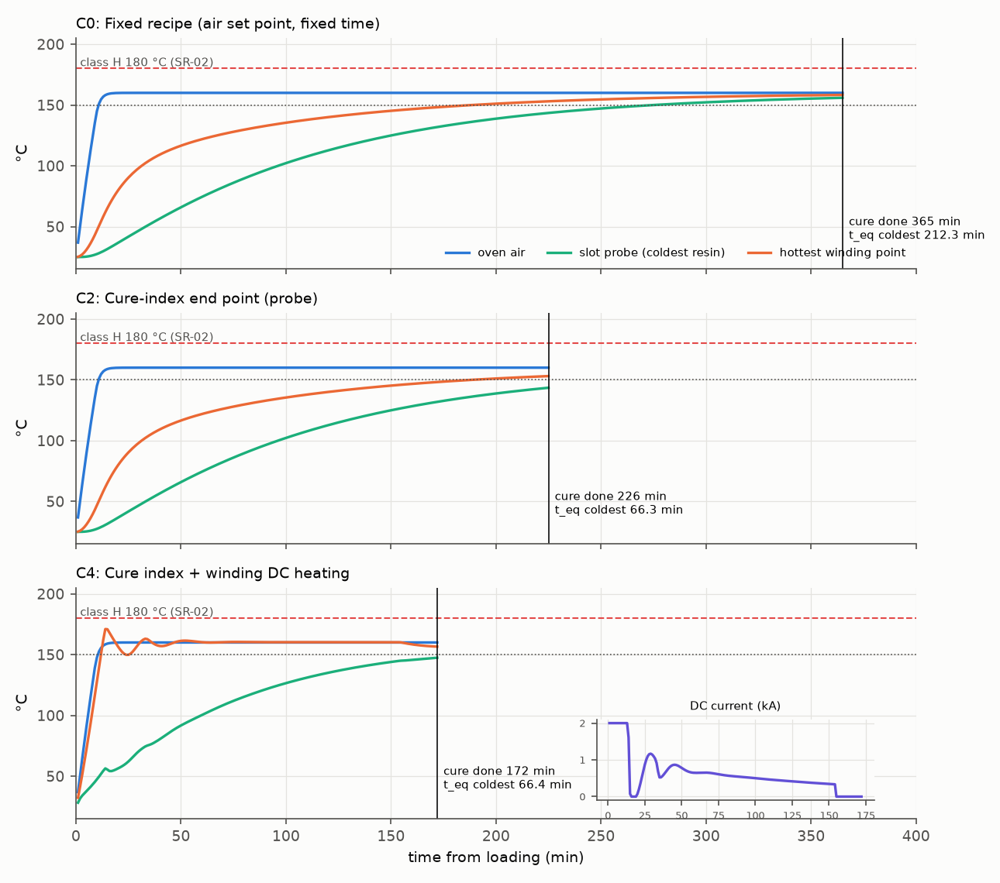
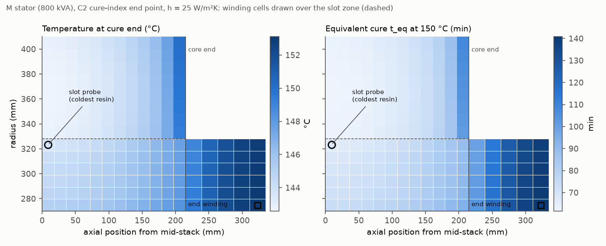
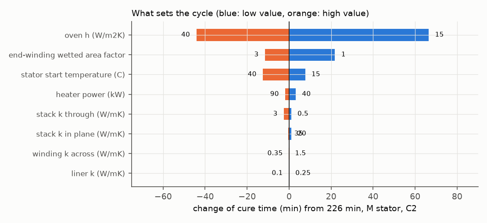

# Stator impregnation cure: heat transfer, end-point control and oven capacity

**Question.** A dipped stator of an LV alternator goes into a curing oven. The resin data sheet asks for 1 h at 150 °C
*object* temperature. How long must the oven cycle really be so that the slowest resin in the winding gets that cure,
which process or control change shortens it safely, and how many oven positions does a plant need when its output is
tripled?

The study runs resin data sheet → cure kinetics → finite-volume stator model → compiled PLC controller in the loop →
trade study, following a systems-engineering spine (need, ConOps, modes, requirements, architecture, budgets,
analysis of alternatives, FMEA, V&V). The full report is **[DOSSIER.md](DOSSIER.md)** (also as
[DOSSIER.pdf](DOSSIER.pdf)).

**Answer.** The cycle is set by heat transfer, not by the resin. The coldest resin is always at the slot bottom in the
middle of the stack. On the 800 kVA stator it reaches the data-sheet cure after 226 min in a 160 °C oven; the resin
itself needs 66 min with margin. **The deciding parameter is the surface heat transfer per heat capacity, h·A/C**:
h = 15 → 40 W/m²K moves the cycle from 292 to 182 min, while ±50 % on every conductivity inside the core moves it by
3 min or less. A fixed recipe that covers three stator sizes on a bad day runs 365 min and needs 17.1 oven positions at
3× output. Ending the cycle on a cure index measured at the slot bottom needs 10.2, an air boost 8.4, DC heating of
the winding 7.8.

Two design rules come from running the real controller code in the loop:
- a cure-index end point without a probe plausibility check ends the cycle at 78 min with the coldest resin at
  2.2 of its 60 min if the thermocouple slips out of the slot;
- DC heating closed on the winding resistance (mean copper temperature) lets the end winding reach 229 °C;
  it must be closed on the end-winding probe as well.



## What is in it

| Level | What | Where |
|---|---|---|
| Resin | Isoconversional cure index with E = 49.2 kJ/mol derived from the data sheet's two equivalent schedules; gel index; VFT viscosity fit; Jeffreys drainage film | `cure/resin.py` |
| Stator | Two-medium (iron + winding) axisymmetric finite-volume model with anisotropic laminations, slot-wall conductance, end winding, Joule heating | `cure/thermal.py` |
| Controller | IEC 61131-3 ST function block `OVEN_CURE`: cure-index end point, gel tracking and rotation, DC-heating PI with anti-windup, resistance thermometer, probe-plausibility observer with fallback, safe states. Compiled with matiec and run in every simulated cycle; TIA Portal SCL export | `plc/st/oven_cure.st`, `plc/scl/OvenCure.scl` |
| Closed loop | Oven air with heater limit, DC supply with current and voltage limits, lagged thermocouples, fault injection of a detached probe | `cure/plant.py` |
| Trade study | Six alternatives × three stator sizes × two oven conditions; gates, capacity at 1–3× output, energy, weighted scores with weight Monte Carlo, sensitivity, resin mismatch | `scripts/run_studies.py` |
| Verification | Every model against an independent result: data-sheet points, Heisler series, Newton cooling, energy balance, ST vs numpy cure index | `tests/` |

## Results (generated from `results/studies.json`)

<!-- TABLE:aoa -->
| | Alternative | Cure time S / M / L (min) | Coldest t_eq S / M / L (min) | Hottest winding (°C) | End-winding film (µm) | Energy M (kWh) | Positions at 3× | Gates |
|---|---|---|---|---|---|---|---|---|
| C0 | Fixed recipe (air set point, fixed time) | 365 / 365 / 365 | 298.1 / 212.3 / 141.5 | 160 | 23.9 | 60.6 | 17.1 | 4/5 |
| C1 | Probe soak timer | 218 / 294 / 379 | 110.0 / 131.4 / 155.0 | 157 | 23.9 | 53.7 | 13.1 | 4/5 |
| C2 | Cure-index end point (probe) | 177 / 226 / 277 | 66.5 / 66.3 / 66.3 | 154 | 23.9 | 46.5 | 10.2 | 5/5 |
| C3 | Cure index + air boost | 144 / 182 / 224 | 66.5 / 66.3 / 66.3 | 167 | 24.3 | 45.7 | 8.4 | 5/5 |
| C4 | Cure index + winding DC heating | 123 / 172 / 220 | 66.4 / 66.4 / 66.4 | 172 | 25.0 | 42.3 | 7.8 | 5/5 |
| C5 | Cure index + DC heating, 150 C air | 128 / 176 / 225 | 66.4 / 66.4 / 66.4 | 172 | 24.8 | 40.4 | 8.0 | 5/5 |
<!-- /TABLE -->





## Run it

```bash
pip install -r requirements.txt
bash scripts/build_plc.sh              # needs matiec (iec2c) and gcc: Linux or WSL
python -m pytest -q                    # model and controller verification
python -m scripts.run_studies          # all closed-loop studies -> results/studies.json
python -m scripts.make_figures         # docs/img/*.png
python -m scripts.make_tables          # writes the tables into DOSSIER.md and README.md
python plc/st_to_scl.py plc/st/oven_cure.st plc/scl/OvenCure.scl
```

CI builds matiec at a pinned commit, compiles the ST code, runs the tests and a quick closed-loop trade study, and
checks that the SCL export matches the ST source.

## Assumptions and limits

The stators are a study family, not products; the 800 kVA one is the stator of the sister study below. Every value
in the dossier is tagged as sourced, derived or assumed, and every assumption that can change a conclusion is varied
(DOSSIER §8.4, §11). The oven heat-transfer coefficient is the one assumption that matters: measure it on the real
oven before releasing a recipe. The resin's activation energy should be confirmed by DSC (DOSSIER DR-04).

Sister projects: [alternator-transient-performance](https://github.com/chad416/alternator-transient-performance)
(the same 800 kVA machine: FEMM, dynamics, ISO 8528-5) and
[alternator-routine-test-station](https://github.com/chad416/alternator-routine-test-station) (the test bench that
measures IR/PI after the cure) and [rotor-bearing-mounting-cell](https://github.com/chad416/rotor-bearing-mounting-cell)
(the robot cell that mounts the rotor bearings).

MIT licence.
